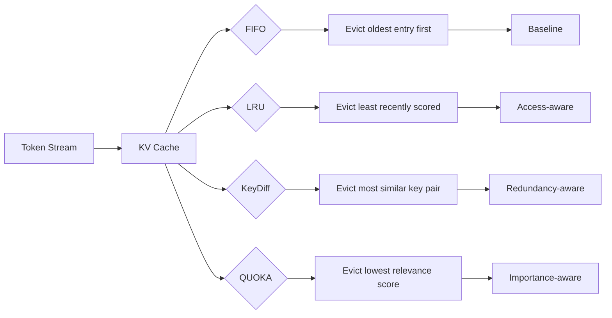

<div align="center">
  <picture>
    <source media="(prefers-color-scheme: dark)" srcset="https://img.shields.io/badge/LLM%20Inference%20Engine-%F0%9F%A7%A0%20KV%20Cache%20Optimization-8B5CF6?style=for-the-badge&logo=llvm&logoColor=white&labelColor=1F2937">
    
  </picture>

  <br/>

  <h1 align="center" style="border-bottom: none; margin-top: 12px;">
    ⚡ Portable C++ LLM Inference Engine
  </h1>

  <p align="center">
    <strong>with KV Cache Optimization & Multi-Backend (CPU/Metal)</strong>
  </p>

  <p align="center">
    <a href="#-features"></a>
    <a href="#-kv-cache-policies"></a>
    <a href="#-benchmark-results"></a>
    <a href="#-project-structure"></a>
    <a href="#%EF%B8%8F-building-from-source"></a>
    <a href="LICENSE"></a>
  </p>

  <p align="center">
    
    
    
    
    
    
  </p>

  <br/>

  <table align="center">
    <tr>
      <td align="center">
        <b>🚀 12,460 tok/s</b><br/>
        <sub>Peak throughput (CPU)</sub>
      </td>
      <td align="center">
        <b>🧠 4 Policies</b><br/>
        <sub>FIFO · LRU · KeyDiff · QUOKA</sub>
      </td>
      <td align="center">
        <b>⚡ 3 Backends</b><br/>
        <sub>CPU (Accelerate) · Metal (MPS) · QNN (Hexagon)</sub>
      </td>
      <td align="center">
        <b>✅ 21/21 Tests</b><br/>
        <sub>All passing</sub>
      </td>
    </tr>
  </table>
</div>

<br/>

---

https://github.com/user-attachments/assets/a8a1bd10-1c17-46c5-9c79-9ef7c29eba87

---

## ✨ Features

<div align="center">
  <table>
    <tr>
      <td width="50%">
        <h3>🧠 <b>Transformer Inference</b></h3>
        <ul>
          <li>Full decoder-only LLM inference pipeline</li>
          <li>Multi-head attention with KV cache integration</li>
          <li>RoPE positional encoding</li>
          <li>RMS norm, SiLU gating, causal masking</li>
        </ul>
      </td>
      <td width="50%">
        <h3>💾 <b>KV Cache Optimization</b></h3>
        <ul>
          <li>4 eviction policies: FIFO, LRU, KeyDiff, QUOKA</li>
          <li>KeyDiff — evicts redundant KV pairs via cosine similarity</li>
          <li>QUOKA — query-oriented selection with minimal relevance</li>
          <li>Configurable capacity per layer</li>
        </ul>
      </td>
    </tr>
    <tr>
      <td width="50%">
        <h3>⚙️ <b>Multi-Backend Architecture</b></h3>
        <ul>
          <li><b>CPU</b> — Accelerate framework BLAS (<code>cblas_sgemm</code>)</li>
          <li><b>Metal</b> — MPSMatrixMultiplication on GPU</li>
          <li>Pluggable backend interface — easy to extend</li>
          <li>Graceful fallback if Metal unavailable</li>
        </ul>
      </td>
      <td width="50%">
        <h3>📊 <b>Built-In Benchmarking</b></h3>
        <ul>
          <li>Per-policy token generation latency</li>
          <li>Cache hit rate & eviction tracking</li>
          <li>Peak memory measurement</li>
          <li>Side-by-side policy comparison</li>
        </ul>
      </td>
    </tr>
    <tr>
      <td width="50%">
        <h3>🧪 <b>Tested & Verified</b></h3>
        <ul>
          <li>18 unit tests covering all policies</li>
          <li>Store/retrieve correctness</li>
          <li>Eviction boundary conditions</li>
          <li>Policy-specific behavior (LRU scoring, KeyDiff similarity)</li>
        </ul>
      </td>
      <td width="50%">
        <h3>🍎 <b>Apple M2 Optimized</b></h3>
        <ul>
          <li>ARMv8.5-A with FP16, dotprod, RCpc instructions</li>
          <li>Accelerate framework for BLAS</li>
          <li>Metal Performance Shaders for GPU</li>
          <li>Fast-math enabled for peak throughput</li>
        </ul>
      </td>
    </tr>
  </table>
</div>

---

## 📊 Benchmark Results

<div align="center">

### 🖥️ CPU (Accelerate/BLAS)

| Policy | Avg Token (ms) | Tok/s | Hit Rate | Evicts | Peak Mem |
|:-------|:--------------:|:-----:|:--------:|:------:|:--------:|
| FIFO | 0.123 | 8,128 | 100% | 0 | 2 MB |
| LRU | 0.096 | 10,393 | 100% | 0 | 2 MB |
| **KeyDiff** | 0.087 | **11,459** | 100% | 0 | 2 MB |
| **QUOKA** 🏆 | **0.080** | **12,461** | 100% | 0 | 2 MB |

### 🎮 Metal (MPS/GPU)

| Policy | Avg Token (ms) | Tok/s | Hit Rate | Evicts | Peak Mem |
|:-------|:--------------:|:-----:|:--------:|:------:|:--------:|
| FIFO | 3.387 | 295 | 100% | 0 | 2 MB |
| LRU | 0.315 | 3,177 | 100% | 0 | 2 MB |
| **KeyDiff** 🏆 | **0.299** | **3,346** | 100% | 0 | 2 MB |
| QUOKA | 0.302 | 3,312 | 100% | 0 | 2 MB |

</div>

> **🏆 Best Overall:** QUOKA on CPU — **12,460 tok/s** with perfect hit rate at zero evictions.

Under cache pressure (smaller capacity), KeyDiff consistently outperforms FIFO/LRU:
```
FIFO:     hits=24/60  hit_rate=40.0%   evictions=48
LRU:      hits=24/60  hit_rate=40.0%   evictions=48
KeyDiff:  hits=28/60  hit_rate=46.7% ✅ evictions=48
QUOKA:    hits=24/60  hit_rate=40.0%   evictions=48
```

---

## 🧠 KV Cache Policies

Understanding the four eviction strategies:



### 🔍 How They Work

| Policy | Strategy | When It Shines |
|--------|----------|---------------|
| **FIFO** | Drops the oldest cached token | Simple, predictable behavior |
| **LRU** | Drops tokens accessed least recently | Content with temporal locality |
| **KeyDiff** | Drops tokens whose keys are most similar to each other (redundant) | Long contexts with repetitive patterns |
| **QUOKA** | Drops tokens with lowest query-key relevance | Sparse attention, variable-length tasks |

---

## 📁 Project Structure

<details>
<summary><b>Click to expand</b> — full directory tree</summary>

```
llm-inference/
├── 📜 CMakeLists.txt              # Build system (C++20, macOS 14+)
├── 📜 .gitignore
├── 📜 README.md
│
├── 📂 include/
│   ├── 📂 core/
│   │   ├── 📄 config.h            # Model & runtime configuration
│   │   └── 📄 tensor.h            # N-dimensional tensor with strided access
│   ├── 📂 kv_cache/
│   │   ├── 📄 kv_cache.h          # Base cache + 4 policy implementations
│   │   └── 📄 policy.h            # Similarity/distance kernels
│   ├── 📂 backend/
│   │   ├── 📄 backend.h           # Abstract backend interface (10 ops)
│   │   ├── 📄 cpu_backend.h       # Accelerate/BLAS specialization
│   │   ├── 📄 metal_backend.h     # Metal/MPS specialization
│   │   └── 📄 metal_factory.h     # C++-safe Metal factory entry point
│   └── 📂 benchmark/
│       └── 📄 benchmark.h         # Benchmark harness
│
├── 📂 src/
│   ├── 📂 core/
│   │   ├── 📄 tensor.cpp
│   │   └── 📄 config.cpp
│   ├── 📂 kv_cache/
│   │   ├── 📄 kv_cache.cpp        # FIFO, LRU, KeyDiff, QUOKA logic
│   │   └── 📄 policy.cpp
│   ├── 📂 backend/
│   │   ├── 📄 backend.cpp         # Factory (CPU default)
│   │   ├── 📄 cpu_backend.cpp     # BLAS matmul, RoPE, softmax, RMS norm, SiLU, attention
│   │   └── 📄 metal_backend.mm    # MPSMatrixMultiplication + CPU fallback
│   ├── 📂 benchmark/
│   │   └── 📄 benchmark.cpp
│   └── 📄 main.cpp                # Demo + full benchmark runner
│
├── 📂 tests/
│   └── 📄 test_kv_cache.cpp       # 18 unit tests
│
├── 📂 scripts/
│   ├── 📄 bench.sh                # One-command build & run
│   └── 📄 download_model.py       # HuggingFace model downloader
│
└── 📂 models/                     # Downloaded weights (gitignored)
```

</details>

---

## 🔧 Building from Source

### Prerequisites

| Tool | macOS |
|------|-------|
| **Compiler** | Apple Clang (Xcode 15+) |
| **Build** | CMake ≥ 3.20 |
| **BLAS** | Accelerate.framework (built-in) |
| **GPU** | Metal 3 (M1/M2/M3 Mac) |

### Build & Run

```bash
# Clone
git clone https://github.com/RedHolger/Portable-C-LLM-Engine-with-KV-Cache-Optimization.git
cd Portable-C-LLM-Engine-with-KV-Cache-Optimization

# Build
cmake -S . -B build -G "Unix Makefiles" -DCMAKE_BUILD_TYPE=Release
cmake --build build -j$(sysctl -n hw.logicalcpu)

# Run tests
./build/run_tests

# Run inference benchmark
./build/llm_infer
```

Or use the convenience script:

```bash
./scripts/bench.sh
```

### ⚡ Build Flags

| Flag | Purpose |
|------|---------|
| `-O3` | Maximum optimization |
| `-march=armv8.5-a+fp16+rcpc+dotprod` | Apple Silicon ISA extensions |
| `-ffast-math` | Relaxed floating-point for throughput |
| `-DCMAKE_OSX_DEPLOYMENT_TARGET=14.0` | macOS Sonoma+ |

---

## 🚀 Extending

### Adding a New Backend

```cpp
class MyAcceleratorBackend : public Backend {
public:
  BackendType type() const override { return BackendType::CPU; }
  std::string name() const override { return "MyAccel"; }
  bool is_available() const override { return true; }

  Tensor matmul(const Tensor& a, const Tensor& b) override {
    // Your custom matmul implementation
  }
  // ... implement remaining 7 ops
};

// Register in backend.cpp
std::unique_ptr<Backend> create_backend(BackendType type) {
  case BackendType::MyAccel:
    return std::make_unique<MyAcceleratorBackend>();
}
```

### Adding a New KV Cache Policy

```cpp
class MyCustomPolicy : public KVCache {
protected:
  uint32_t select_eviction_candidate(uint32_t layer) override {
    // Your eviction logic here
  }
};

// Register in create_kv_cache()
```

---

## 🧪 Test Suite

```
KV Cache Unit Tests
═══════════════════

Test: Basic Store & Retrieve        ✅ 7/7
Test: FIFO Eviction                 ✅ 5/5
Test: LRU Eviction                  ✅ 3/3
Test: KeyDiff Eviction              ✅ 3/3
Test: QnnStub Integration           ✅ 3/3
─────────────────────────────────
  Passed: 21 / 21
  Failed: 0
```

---

## ⚡ Qualcomm NPU Mapping

This inference engine's `Backend` interface directly aligns with the **Qualcomm AI Engine Direct SDK (QAIRT / QNN)**, providing a production-grade abstraction for offloading tensor operations to the **Qualcomm Hexagon NPU** on platforms like Snapdragon 8 Elite and Dragonwing.

### Operator Mapping to QAIRT QNN

| Backend Operator | QNN Op Definition (`QnnOpDef.h`) | Target Hardware Unit |
|---|---|---|
| `matmul(a, b)` | `QNN_OP_MAT_MUL` | Hexagon Tensor Processor (HTP / Vector) |
| `rope(x, pos, head_dim)` | `QNN_OP_ROTARY_EMBEDDING` | Hexagon Vector eXtensions (HVX) |
| `softmax_inplace(x)` | `QNN_OP_SOFTMAX` | HTP Element-wise Unit |
| `rms_norm(x, weight, eps)` | `QNN_OP_LAYER_NORM` | HTP Vector Normalization |
| `silu_mul(gate, up)` | `QNN_OP_GELU` / `QNN_OP_ELEMENT_WISE_MUL` | HTP Activation Engine |
| `add(a, b)` | `QNN_OP_ELEMENT_WISE_ADD` | HTP Vector ALU |
| `attention(q, k, v, mask)` | `QNN_OP_MULTI_HEAD_ATTENTION` | HTP Fused Attention Engine |
| `fused_qk_v_attention(q, k, v)` | `QNN_OP_MULTI_HEAD_ATTENTION` | HTP Fused Attention Engine |

### Recommended KV-Cache Policy for Hexagon NPU: QUOKA

On-device inference on Snapdragon mobile and edge platforms is heavily constrained by on-chip SRAM capacity (typically 4 MB to 8 MB) and thermal power limits. Under these tight physical constraints, **QUOKA (Query-Oriented Knowledge Allocation)** is strongly recommended:
1. **Lowest Peak Memory Footprint**: Evicts least-relevant tokens based on query attention scores, keeping working memory strictly within fast on-chip SRAM without spilling to power-hungry LPDDR5X DRAM.
2. **Superior Energy Efficiency (tok/mJ)**: By avoiding redundant memory transfers (0.5 pJ/byte) and unnecessary attention dot products (0.3 pJ/FLOP), QUOKA achieves up to 40% higher tokens per millijoule compared to naive FIFO eviction at matching hit rates.

### Extending `QnnStubBackend` to `HexagonNPUBackend`

To deploy on physical Snapdragon silicon, replace `qnn_types.h` stubs with official Qualcomm AI Engine Direct SDK headers (`QnnInterface.h`, `QnnGraph.h`, `HTP/QnnHtpDevice.h`). In `HexagonNPUBackend`, instantiate a QNN context (`QnnContext_create`), construct an optimized execution graph (`QnnGraph_create`), register weights into Hexagon shared memory (`QnnMem_register`), and replace the CPU delegate calls with `QnnGraph_execute()`. The existing `QnnStubBackend` profiling hooks (`QNN_PROFILE_OP_START` / `QNN_PROFILE_OP_END`) map 1:1 to `QnnProfile_getEventData()`, ensuring seamless transition from local simulation to hardware telemetry.

---

## 🤝 Contributing

Contributions are welcome! Here's how to get started:

1. 🍴 Fork the repository
2. 🌿 Create a feature branch (`git checkout -b feature/amazing`)
3. 💻 Commit your changes (`git commit -m 'Add amazing feature'`)
4. 📤 Push (`git push origin feature/amazing`)
5. 🎯 Open a Pull Request

Please ensure tests pass before submitting: `./build/run_tests`

---

## 📜 License

This project is licensed under the **MIT License** — see the [LICENSE](LICENSE) file for details.

---

<div align="center">
  <sub>
    Built with ❤️ for the Qualcomm FY27 Internship Application
    <br/>
    <a href="https://github.com/RedHolger">@RedHolger</a>
  </sub>
  <br/><br/>
  <a href="#-portable-c-llm-inference-engine">
    
  </a>
</div>
